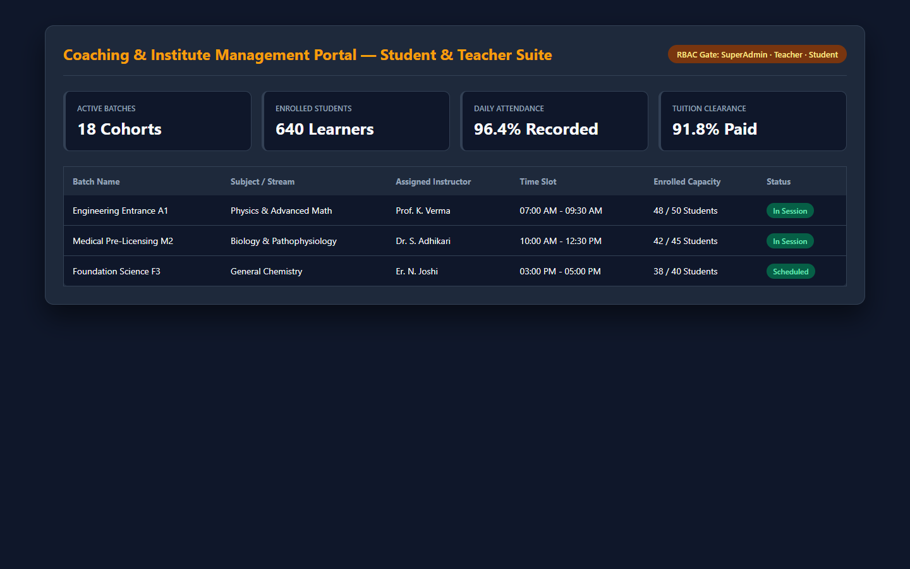
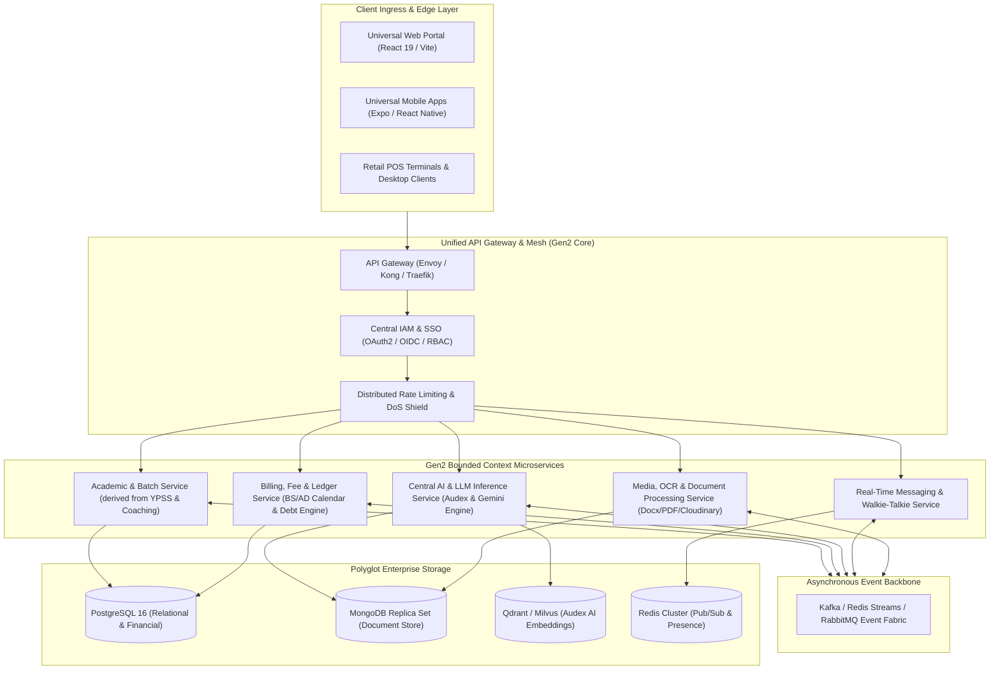
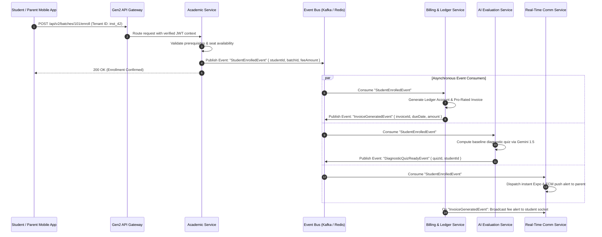

# Gen2 — Next-Generation Enterprise & Institutional Microservices Incubator

[](https://opensource.org/licenses/MIT)
[](https://microservices.io/)
[-0052CC)](https://martinfowler.com/tags/domain%20driven%20design.html)
[](https://grpc.io/)
[](https://github.com)
[](https://prometheus.io/)
[](https://kubernetes.io/)

---

## Application Screenshot & Interface Preview

<div align="center">
  
</div>

---

## 📋 Executive Summary & Mission

The institutional software landscape across our product ecosystem—encompassing **YPSS** (Comprehensive School & Institute ERP), **Audex** (AI Intelligence & Model Evaluation Suite), the **Coaching Suite** (`coaching_app` & `coaching_app_backend`), and **Retail OS** (`STORE_HANDLING` & `sonisurgical-backend`)—has grown into a powerful constellation of production applications.

However, scaling these independent systems to serve hundreds of thousands of concurrent institutions, students, and businesses reveals fundamental enterprise challenges:
1. **Redundant Infrastructure & Logic**: User authentication, push notifications (FCM & Expo), Cloudinary media ingestion, and billing schedulers are implemented independently across repositories.
2. **Database Monopolies & Coupling**: Multiple domains depend on local MongoDB or MySQL instances without unified data governance, cross-service event replication, or shared audit logs.
3. **Variable AI Integrations**: AI endpoints (Google Gemini 1.5 Pro, Flash) use custom rate limiting, caching, and key rotation techniques across repositories instead of an optimized, centralized LLM inference gateway.

**Gen2** serves as the **architectural blueprint, shared contract incubator, and evolutionary migration framework** designed to unify these independent suites into a cohesive, high-performance, cloud-native **microservices platform**.

---

## 🏛️ Ecosystem Integration Map



---

## 🧩 Domain Boundaries (Bounded Contexts)

Following strict **Domain-Driven Design (DDD)** principles, Gen2 establishes clear boundaries and unambiguous ubiquitous language across the unified enterprise:

### 1. 🛡️ Identity, Tenant & Access Management (IAM)
- **Role**: Single source of truth for all users, schools, coaching centers, pharmacies, and retail stores.
- **Tenancy**: Multi-tenant database partitioning with tenant isolation (`tenant_id`).
- **Protocols**: OAuth 2.0, OpenID Connect (OIDC), JWT with cryptographic RS256 signatures.
- **Inherited From**: Unified consolidation of `coaching_app_backend` RBAC, `STORE_HANDLING` 7-tier staff roles, and `YPSS` auth.

### 2. 🎓 Academic & Institutional Lifecycle
- **Role**: Curriculums, grades, student batches, academic calendars, attendance registries, and timetables.
- **Components**:
  - Timetable constraint satisfaction engine (integrating algorithms from `timetableschedular`).
  - Student admission triage and approval pipelines (`approvedOnly` gate).
  - Automated batch lifecycle state machine (`Upcoming` ➔ `Ongoing` ➔ `Completed`).
- **Inherited From**: `YPSS` (Classes, MarksCards) and `coaching_app_backend` (Batches).

### 3. 💳 Financial Ledger, Invoicing & Dual-Calendar Billing
- **Role**: Enterprise invoicing, fee generation, debt aging analysis, and credit ledgers.
- **Key Capabilities**:
  - **Bikram Sambat (BS) & Gregorian (AD)** dual calendar financial calculation engine (from `sonisurgical-backend`).
  - Automated recurring monthly fee scheduling and receipt counter sequence generators (`Counter.js`).
  - Multi-gateway payment webhooks (Stripe, UPI, eSewa, Khalti).
  - Audit-proof customer credit and due balance ledgers with transaction pruning safeguards.

### 4. 🧠 Central AI & LLM Evaluation Gateway
- **Role**: High-throughput inference gateway, prompt caching, model benchmark tracking, and agentic workflows.
- **Key Capabilities**:
  - LLM evaluation pipelines, ranking algorithms, and daily data scraping (from `Audex_AI_backend`).
  - Multi-key round-robin rotation and automated failover (from `sonisurgical-backend`).
  - Multimodal exam question paper generation and automated OCR assessment (from `YPSS`).
  - Real-time conversational AI copilot endpoints (from `Web-Based-Real-Time-AI-Chat-Application`).

### 5. 📡 Real-Time Communication & Presence Fabric
- **Role**: Low-latency bidirectional messaging, presence tracking, and push notification fan-out.
- **Key Capabilities**:
  - WebSockets and Socket.IO dedicated rooms (`request_<id>`, `class_<id>`).
  - PTT (Push-To-Talk) walkie-talkie audio streaming channels (from `YPSS`).
  - Unified mobile alert dispatcher abstracting Apple APNs, Google FCM, and Expo Push Notifications.

### 6. 📄 Document Ingestion, OCR & Media Processing
- **Role**: Asynchronous compute workers for intensive media and document generation.
- **Key Capabilities**:
  - High-fidelity Word (`.docx`) template synthesis and headless LibreOffice PDF compilation (from `YPSS`).
  - Proof-of-purchase receipt image compression and Cloudinary CDN streaming (from `sonisurgical-backend` & `STORE_HANDLING`).

---

## 🔄 Cross-Domain Event Choreography Sequence



---

## 🗺️ Microservices Migration Roadmap

```text
+---------------------------------------------------------------------------------------+
| PHASE 0: Monolith Decoupling & Shared Contracts (Current State)                       |
| • Extract and document OpenAPI 3.1 specifications across all 7 repositories           |
| • Standardize environment configuration (.env.example) and zero-leakage .gitignore    |
| • Formalize schema interfaces for User, Batch, Transaction, and Media                 |
+---------------------------------------------------------------------------------------+
                                           │
                                           ▼
+---------------------------------------------------------------------------------------+
| PHASE 1: Unified API Gateway & Shared IAM Identity Provider                           |
| • Deploy centralized API Gateway (Kong / Envoy) handling TLS termination and routing  |
| • Stand up central Identity Provider (Node.js/Go) issuing unified RS256 JWT tokens    |
| • Introduce tenant context headers (X-Tenant-ID) across all incoming requests         |
+---------------------------------------------------------------------------------------+
                                           │
                                           ▼
+---------------------------------------------------------------------------------------+
| PHASE 2: Bounded Context Extraction & Domain Consolidation                            |
| • Consolidate coaching_app_backend and YPSS academic entities into Academic Service   |
| • Extract Nepali BS/AD date conversion and credit ledgers into Financial Service      |
| • Consolidate Audex scraping, rankings, and Gemini API keys into Central AI Gateway   |
+---------------------------------------------------------------------------------------+
                                           │
                                           ▼
+---------------------------------------------------------------------------------------+
| PHASE 3: Event-Driven Asynchronous Backbone                                           |
| • Deploy Apache Kafka or Redis Streams message bus                                    |
| • Decouple cron jobs into event-driven scheduled tasks (via temporal.io / BullMQ)     |
| • Implement outbox pattern for guaranteed message delivery between services           |
+---------------------------------------------------------------------------------------+
                                           │
                                           ▼
+---------------------------------------------------------------------------------------+
| PHASE 4: Global Observability, Service Mesh & Multi-Cloud Elasticity                  |
| • Instrument all microservices with OpenTelemetry distributed tracing                 |
| • Deploy Prometheus & Grafana centralized observability dashboards                    |
| • Package microservices into Helm charts for production Kubernetes (EKS / GKE)        |
+---------------------------------------------------------------------------------------+
```

---

## 📐 Unified gRPC Contract Blueprint (Sample Service Interface)

```protobuf
syntax = "proto3";

package gen2.academic.v1;

option go_package = "gen2/academic/v1;academicv1";

service AcademicService {
  rpc GetBatchRoster (GetBatchRosterRequest) returns (GetBatchRosterResponse);
  rpc EnrollStudent (EnrollStudentRequest) returns (EnrollStudentResponse);
  rpc TransitionBatchStatus (TransitionStatusRequest) returns (BatchEntity);
}

message BatchEntity {
  string batch_id = 1;
  string tenant_id = 2;
  string name = 3;
  string subject = 4;
  string teacher_id = 5;
  string status = 6; // UPCOMING, ONGOING, COMPLETED
  double monthly_fee = 7;
  int64 start_timestamp = 8;
  repeated string student_ids = 9;
}

message EnrollStudentRequest {
  string tenant_id = 1;
  string batch_id = 2;
  string student_id = 3;
}

message EnrollStudentResponse {
  bool success = 1;
  string enrollment_id = 2;
  string message = 3;
}
```

---

## 🛠️ Target Tech Stack Matrix

| Layer | Standardized Technology | Rationale |
| :--- | :--- | :--- |
| **API Gateway** | Kong / Envoy Proxy | Sub-millisecond routing, rate limiting, OAuth2 plugins |
| **Microservice Runtimes** | Node.js (v20+ LTS) / Go (1.22+) | High async I/O throughput, low resource overhead |
| **Inter-Service RPC** | gRPC / Protocol Buffers v3 | Strongly typed contracts, binary compression, multiplexing |
| **Message Broker** | Apache Kafka / Redis Streams | High-throughput durable event streaming and replay |
| **Core Primary DB** | PostgreSQL 16 (TimescaleDB) | ACID compliance for financial ledgers, partitioned tables |
| **Document Store** | MongoDB Atlas 8.x | Flexible schema for student portfolios, exam papers |
| **AI Vector Store** | Qdrant / Milvus | High-speed semantic similarity for Audex LLM rankings |
| **Distributed Cache** | Redis Cluster 7.x | Fast session storage, presence tracking, token blacklists |
| **Telemetry** | OpenTelemetry + Prometheus + Jaeger | Distributed traces, latency profiling, metric collection |
| **Container Mesh** | Docker & Kubernetes (K8s) | Declarative rolling updates, auto-scaling, self-healing |

---

## 📂 Incubator Repository Structure

```text
Gen2/
├── docs/                             # Architecture Decision Records (ADRs)
│   ├── adr-001-event-driven-bus.md   # Kafka / Redis streams selection rationale
│   ├── adr-002-iam-consolidation.md  # Unified OAuth2 / OIDC token blueprint
│   └── adr-003-dual-calendar-db.md   # Bikram Sambat & Gregorian schema design
├── proto/                            # Protocol Buffer contract definitions
│   ├── academic/v1/academic.proto    # Batches, classes, enrollment RPCs
│   ├── finance/v1/billing.proto      # Invoices, credit ledger, BS/AD dates
│   ├── ai/v1/inference.proto         # Gemini inference, key rotation, benchmarks
│   └── comms/v1/notifications.proto  # Unified push, socket rooms, walkie-talkie
├── gateways/                         # Gateway configurations
│   ├── envoy.yaml                    # Envoy proxy edge routing specification
│   └── kong.yaml                     # Kong Gateway route plugins & rate limits
├── schemas/                          # Unified JSON Schema and database migration DDLs
│   ├── postgres/                     # Relational schemas for billing, accounts, and audits
│   └── mongo/                        # Document schemas for examinations and portfolios
├── specs/                            # OpenAPI 3.1 specifications for external developers
│   └── api-v2-spec.yaml              # Complete consolidated RESTful API definition
├── .gitignore                        # Git exclusion rules
└── README.md                         # Core incubator architecture blueprint
```

---

## 🛡️ Enterprise Security & Resilience Guidelines

1. **Zero-Trust Network Architecture (ZTNA)**: Mutual TLS (mTLS) enforced across all inter-service gRPC communication channels.
2. **Tenant Data Isolation**: Database-level Row-Level Security (RLS) on PostgreSQL and automatic query filtering by `tenant_id` on MongoDB collections.
3. **Graceful Degradation & Circuit Breaking**: AI services and push dispatchers wrap outbound calls in circuit breakers (Resilience4j / Opossum) with local fallback execution.
4. **Idempotent Billing & Invoicing**: All financial commands carry unique `Idempotency-Key` headers to guarantee zero double-billing during network retries.

---

## 📄 License
This incubator project is licensed under the [MIT License](LICENSE).
